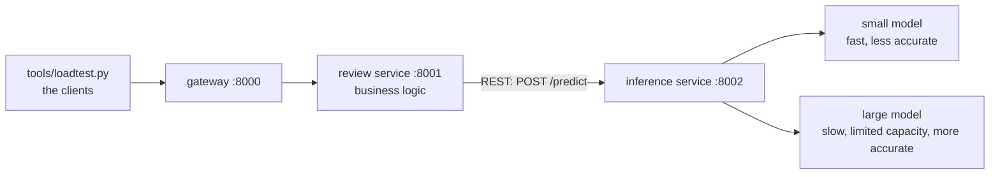
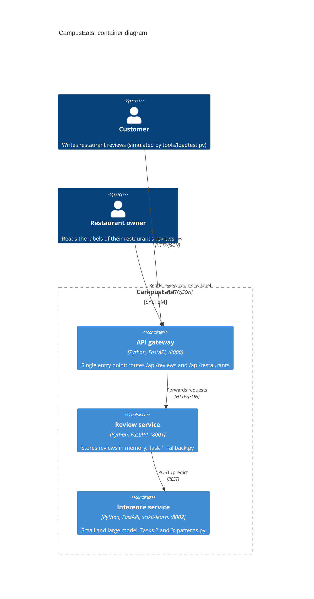

# Tutorial 6: Serving patterns for an AI-enabled system

**2110521 Software Architecture · Week 13** · [ภาษาไทย](README.md)

CampusEats is a campus food-delivery app. Customers review restaurants, and every review gets a sentiment label from an ML model so restaurant owners can spot unhappy customers quickly.

You get a working system with three services. Your job is to add three patterns from the lecture around the model: **fallback prediction**, **cascade (two-phase prediction)** and **cached predictions**. Then you measure what each one does to latency, cost and accuracy, and use those numbers to choose a deployment topology in **Assignment 6**.



The same system as a C4 container diagram:



| Service | Folder | Your work |
|---|---|---|
| API gateway (as in W11) | `gateway/` | none |
| Review service: the business service | `review_service/` | **Task 1** in `fallback.py` |
| Inference service: model as a service | `inference_service/` | **Tasks 2 and 3** in `patterns.py` |

The large model stands in for an expensive model, such as a GPU-hosted model or a paid LLM API. Its predictions are real, but its slowness is simulated: each call takes about 200 ms, and only 4 calls run at once.

## Before class (10 minutes, at home)

You need **Python 3.10 or newer** and **git**. No Docker, no API keys.

1. **Fork** this repository on GitHub, then clone **your fork**.
2. Create a virtual environment and install the packages:

   ```bash
   cd swarch-arch4AI
   python3 -m venv .venv                # Windows: py -m venv .venv
   source .venv/bin/activate            # Windows: .venv\Scripts\activate
   pip install -r requirements.txt
   ```

3. Check that it runs:

   ```bash
   python run_all.py
   ```

   You should see three URLs and "All services are up". Stop it with **Ctrl+C**.

## How to work

Keep **two terminals** open, both with the virtual environment activated:

- **Terminal 1:** `python run_all.py`. Restart it (Ctrl+C, then run it again) **after every code change**.
- **Terminal 2:** run the tests and the load tests.

The load test sends 200 reviews through the gateway and prints one row of results. Every row is also appended to `results/runs.csv`, which you submit.

```bash
python tools/loadtest.py --name baseline
```

| Column | Meaning |
|---|---|
| `p50_ms`, `p95_ms` | latency seen by the client: half / 95% of requests were faster |
| `errors` | requests that failed, or got no answer within 10 s |
| `pending` | reviews saved without a label (your Task 1 fallback) |
| `accuracy` | correct labels among the reviews that did get a label |
| `large_calls` | share of requests that reached the large model: this is your **cost** |
| `cache_hits` | share of requests answered from the cache |

**By hand or with an AI agent: your choice.** Each task is a small TODO (4–25 lines). You can write it yourself, or ask any coding agent (Copilot, Gemini Code Assist, Claude Code, Codex, Cursor, …) to do it. The agent's rules are in [`AGENTS.md`](AGENTS.md). Either way, record in the worksheet how each task was done and what you had to fix. **The answers to the questions and the ADR must be your own reasoning.**

## Tasks (≈ 75 minutes)

Write your results and answers in [`worksheet/tutorial6.md`](worksheet/tutorial6.md).

| Time | Step |
|---|---|
| 0:00 | **Task 0** Baseline (10 min) |
| 0:10 | **Task 1** Fallback prediction (15 min) |
| 0:25 | **Task 2** Cascade (20 min) |
| 0:45 | **Task 3** Cached predictions (10 min) |
| 0:55 | **Assignment 6** Deployment decision (15 min) |
| 1:10 | Debrief, then commit, push and submit (5 min) |

### Task 0: Baseline

```bash
python tools/loadtest.py --name t0-large                    # every review goes to the large model
python tools/loadtest.py --name t0-small --strategy small   # every review goes to the small model
```

### Task 1: Fallback prediction (`review_service/fallback.py`)

Turn on chaos: 10% of large-model calls now **hang** for 20 seconds, without any error or log line.

```bash
python tools/loadtest.py --name t1-before --hang-rate 0.1
```

Look at `errors` and how long the run took. Then implement `classify()`: give the call a timeout (`settings.INFERENCE_TIMEOUT_S`, 1 s) and, when the call times out or fails, return a **pending** review instead of failing. The review is saved, and a batch job can label it later.

```bash
python -m pytest tests/test_task1_fallback.py
# restart run_all.py, then:
python tools/loadtest.py --name t1-after --hang-rate 0.1
```

### Task 2: Cascade (`inference_service/patterns.py`)

Implement `cascade()`: ask the small model first, and the large model only when the small model's confidence is below a threshold.

```bash
python -m pytest tests/test_task2_cascade.py
# restart run_all.py, then try several thresholds:
python tools/loadtest.py --name t2-0.6 --strategy cascade --threshold 0.6
python tools/loadtest.py --name t2-0.7 --strategy cascade --threshold 0.7
python tools/loadtest.py --name t2-0.8 --strategy cascade --threshold 0.8
python tools/loadtest.py --name t2-0.9 --strategy cascade --threshold 0.9
```

### Task 3: Cached predictions (`inference_service/patterns.py`)

Implement `PredictionCache`: the same review text (ignoring case and extra spaces) gets the stored answer. Keep at most `max_size` entries and evict the least recently used.

```bash
python -m pytest tests/test_task3_cache.py
# restart run_all.py, then use your chosen threshold from Task 2:
python tools/loadtest.py --name t3-cache --strategy cascade --threshold 0.7 --cache on
```

### Assignment 6: Deployment topologies and trade-offs

Follow [`worksheet/assignment6.md`](worksheet/assignment6.md): choose a deployment topology for one CampusEats scenario, back it with your measurements, and record it as an ADR.

### Stretch (optional)

- **Fallback to a local model.** Instead of `pending`, fall back to the small model running *inside* the review service (model as a library). What happens to accuracy, latency and coupling?
- **Score pending reviews later.** Write a small batch job that reads `GET /reviews/pending` and labels them: the batch processing topology from the lecture.

## Submit (by the end of class)

```bash
git add worksheet/ results/ review_service/ inference_service/
git commit -m "Tutorial 6 and Assignment 6"
git push
```

Submit **the URL of your fork** on MyCourseVille.

## Troubleshooting

| Problem | Fix |
|---|---|
| `Cannot reach the services` | Is `python run_all.py` running in the other terminal? |
| `address already in use` | An earlier `run_all.py` is still running. Stop it with Ctrl+C or close that terminal. |
| Every request fails, `NotImplementedError` in terminal 1 | You ran a strategy whose TODO is not done yet. |
| My change has no effect | Restart `run_all.py` after every code change. |
| `ModuleNotFoundError` | Activate the virtual environment, and run commands from the repository's root folder. |
| Port 8000–8002 is taken by something else | Set other ports, e.g. `GATEWAY_PORT=9000 REVIEW_PORT=9001 INFERENCE_PORT=9002`, in **both** terminals. |
