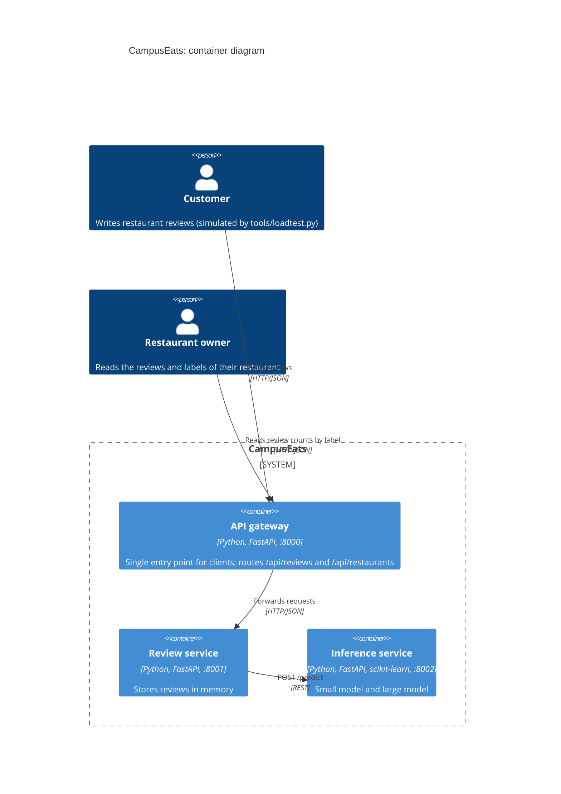
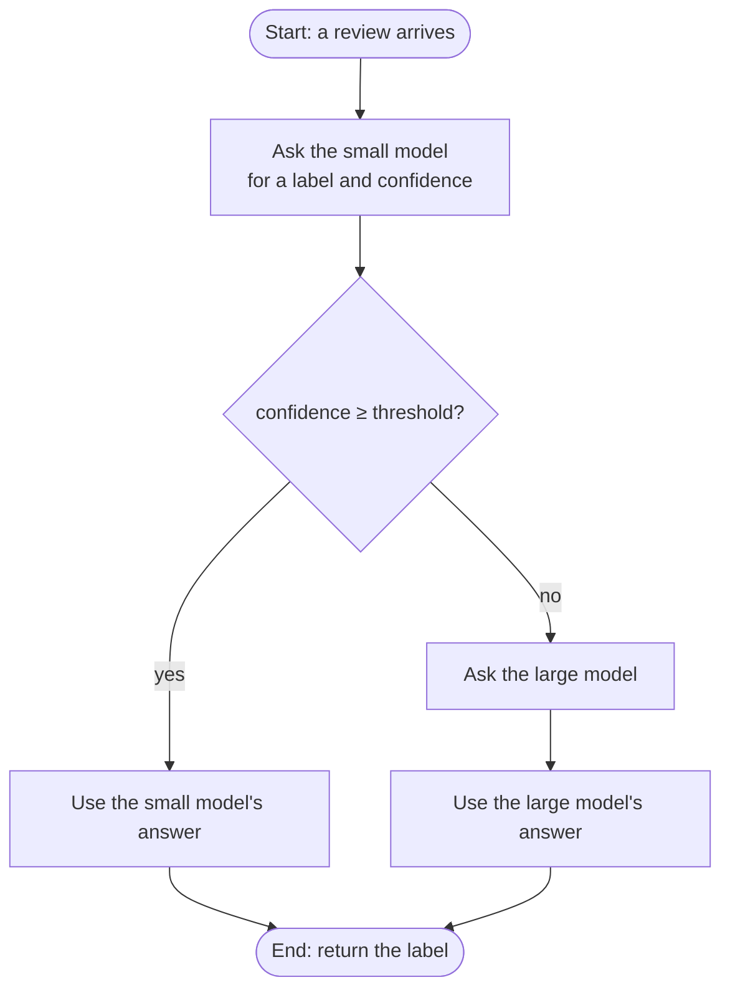

# Tutorial 6: Design patterns for an AI-enabled system

**2110521 Software Architecture · Week 13** · [ภาษาไทย](README.md)

*This is **individual work**: each student completes and submits their own work, in their own forked repository.*

## Files for your answers

* `worksheet/tutorial6.md`
* `worksheet/assignment6.md`

## About the CampusEats system

CampusEats is a campus food-ordering app that lets customers write restaurant reviews. Every review is processed by a machine learning model, which gives it a sentiment label (positive / negative), so restaurant owners can spot unhappy customers quickly and improve their service in time.

In this repository you get a system that already works, made of 3 services. Your job is to add 3 design patterns around the model:

* (1) fallback prediction
* (2) cascade (two-phase prediction)
* (3) cached predictions

Then you measure what each pattern does to the system's latency, cost and accuracy, and use those numbers to choose a deployment topology.

The C4 container diagram of CampusEats is shown below.



| Service | Folder | Your work |
|---|---|---|
| API gateway | `gateway/` | none |
| Review service: business service | `review_service/` | **Task 1** in `fallback.py` |
| Inference service: model as a service | `inference_service/` | **Tasks 2 and 3** in `patterns.py` |

## CampusEats requirements

These are the requirements of the current system. During this exercise, you will change or add to some of them.

**Functional requirements**

| # | Requirement |
|---|---|
| FR1 | A customer can post a review of a restaurant (restaurant name and review text) |
| FR2 | Every review gets a sentiment label (`positive` or `negative`) |
| FR3 | A restaurant owner can see their restaurant's review counts by label |
| FR4 | If a review cannot be labelled, it is saved as `pending` and labelled later (no review is lost) |

**Non-functional (quality) requirements**

| # | Quality | Requirement |
|---|---|---|
| QR1 | Performance | 95% of reviews get an answer within 1 s, with 10 requests in flight |
| QR2 | Availability | If the inference service is slow or stuck, posting a review must not fail. The review service waits at most 1 s |
| QR3 | Accuracy | At least 90% of labelled reviews get the correct label |
| QR4 | Cost | Send as few reviews as possible to the large model, without breaking QR3 |
| QR5 | Capacity | The system must work within the large model's limit: at most 20 calls per second (4 at once × about 200 ms) |

## Two models, three strategies

The inference service in this system has **two** sentiment models (see the code in `inference_service/models.py`). Both are trained from `data/train.csv`.

| | Small model | Large model |
|---|---|---|
| What it looks at | the 100 most common single words (bag of words) | single words, word pairs and triples (TF-IDF, 1–3-grams), so it understands phrases like "not bad" |
| Speed | well under 1 ms per call | about 200 ms per call, and only 4 calls run at once |
| Accuracy | lower: it often misreads negations ("not cold") and "but" contrasts | higher |
| Cost | almost free | every call costs money |

In this exercise, the large model stands in for an expensive ML model, such as a large model that must run on a GPU or a paid LLM API. Its predictions are real, but its slowness is simulated.

Both models answer in the same shape: a **label** and a **confidence**, the probability the model gives to the label it chose. Confidence runs from 0.5 (a coin flip) to 1.0 (very sure). An example answer from `POST /predict`:

```json
{"label": "negative", "confidence": 0.93, "model": "large", "latency_ms": 212.4}
```

A **strategy** is how the inference service uses the two models to answer each request. You pick it with the load test's `--strategy`:

- **`large`** (the default): every review goes to the large model. The most accurate, but the slowest and most expensive.
- **`small`**: every review goes to the small model. The fastest and cheapest, but less accurate.
- **`cascade`** (you implement it in Task 2): ask the small model first. If its confidence is high enough (at least `--threshold`), use its answer. Otherwise, send the review on to the large model. The goal is to get close to the large model's accuracy while paying for the large model only on the hard reviews.



The cascade is not a third model: it combines the two you already have. In Task 0 you measure how far apart `large` and `small` are, and in Task 2 you measure where the cascade lands between them.

## Setting up the environment

You need **Python 3.10 or newer** and **git**.

1. **Fork** this repository on GitHub, then clone **your fork**.
2. Create a virtual environment and install the packages:

   ```bash
   cd swarch-arch4AI
   python3 -m venv .venv                # Windows: py -m venv .venv
   source .venv/bin/activate            # Windows: .venv\Scripts\activate
   pip install -r requirements.txt
   ```

3. Check that it runs:

   ```bash
   python run_all.py
   ```

   You should see three URLs and "All services are up". Press **Ctrl+C** to stop.

## How to work

Open **two terminals** and activate the virtual environment in both:

- **Terminal 1:** `python run_all.py`. Restart it (Ctrl+C, then run it again) **every time you change the code**.
- **Terminal 2:** run tests and load tests.

The load test sends 200 reviews through the gateway and prints one row of results. Every row is also appended to `results/runs.csv`, which you submit.

```bash
python tools/loadtest.py --name baseline
```

Example output:

```text
  200/200 requests
  finished in 10.0 s

  name      hang_rate  strategy  threshold  cache  n    p50_ms  p95_ms  errors  pending  accuracy  large_calls  cache_hits
  baseline  0.0        large                off    200  497     581     0       0        93.5%     100%         0%
```

| Column | Meaning |
|---|---|
| `name` | the label you gave the run with `--name` |
| `hang_rate` | share of large-model calls made to hang for 20 s (`--hang-rate`, used in Task 1) |
| `strategy` | which model answers (`--strategy`): `large` (default), `small` or `cascade` (you implement it in Task 2) |
| `threshold` | the cascade's confidence threshold (`--threshold`); empty unless the strategy is `cascade` |
| `cache` | whether the prediction cache is on (`--cache on`, you implement it in Task 3) |
| `n` | number of reviews sent in the run |
| `p50_ms`, `p95_ms` | latency seen by the client: half (p50_ms) / 95% (p95_ms) of requests were faster than this |
| `errors` | requests that failed, or got no answer within 10 s |
| `pending` | reviews saved without a label (the Task 1 fallback) |
| `accuracy` | correct labels among the reviews that did get a label |
| `large_calls` | share of requests that reached the large model: this is the **cost** |
| `cache_hits` | share of requests answered from the cache |

#### Note 1: How to read `p50_ms` and `p95_ms`

The load test times each request from the moment the client sends the review until the answer comes back (in milliseconds). Then it sorts all the times from fastest to slowest:

- **`p50_ms` (the median, 50th percentile):** the time of the request in the middle. Half the requests were faster and half were slower. This is what a "typical" user sees.
- **`p95_ms` (95th percentile):** 95% of requests were faster than this. With 200 requests, it is roughly the 10th-slowest one. This is the **tail latency**: what an unlucky user sees.

For example, in the output above `p50_ms` = 497 and `p95_ms` = 581. Half the reviews got an answer within about half a second, and 19 out of 20 within 0.58 s. The remaining 1 in 20 took longer.

#### Note 2: Write the code by hand or with an AI agent

Each task is a short TODO (4–25 lines). You can write it yourself, or ask any coding agent (Copilot, Claude Code, Codex, Cursor, …) to do it. The agent's rules are in [`AGENTS.md`](AGENTS.md). **However, the answers to the questions and the ADR must be your own reasoning.**

## Tasks

Write your results and answers in [`worksheet/tutorial6.md`](worksheet/tutorial6.md).

| Time | Step |
|---|---|
| 0:00 | **Task 0** Baseline (10 min) |
| 0:10 | **Task 1** Fallback prediction (15 min) |
| 0:25 | **Task 2** Cascade (20 min) |
| 0:45 | **Task 3** Cached predictions (10 min) |
| 0:55 | **Task 4** Deployment decision (15 min) |
| 1:10 | Debrief, then commit, push and submit (5 min) |

### Task 0: Baseline

```bash
python tools/loadtest.py --name t0-large                    # every review goes to the large model
python tools/loadtest.py --name t0-small --strategy small   # every review goes to the small model
```

Look at the results of the two runs: how do the large and small models differ?

### Task 1: Fallback prediction (`review_service/fallback.py`)

In this task you break the system on purpose, to see whether it copes before the same failure happens in production. This is called **chaos testing** (or chaos engineering).

The option `--hang-rate 0.1` makes the large model **hang** on 10% of calls (a random 1 in 10): that call waits 20 seconds before answering. It does not crash, return an error or write anything to the log. The other 90% of calls work normally. This happens in real systems, for example an overloaded GPU server or an LLM API that just stalls, and it is more dangerous than a crash, because nobody notices. The load test's client waits only 10 seconds, then counts the request as one of the `errors`.

```bash
python tools/loadtest.py --name t1-before --hang-rate 0.1
```

#### What to do in Task 1

Look at `errors` and the run time. Then write the code in `classify()`: give the call a timeout (`settings.INFERENCE_TIMEOUT_S` = 1 s), and on a timeout or an error, return a review with status **pending** instead of failing. The review is still saved, and a batch job can label it later.

```bash
# 1) run the unit tests
python -m pytest tests/test_task1_fallback.py
# 2) restart run_all.py in terminal 1 (Ctrl+C, then run it again)
# 3) run the load test again
python tools/loadtest.py --name t1-after --hang-rate 0.1
```

The three steps, in order:

1. **Run the unit tests (with `pytest`):** they check that `classify()` works correctly. Each test starts a fake inference service: one that answers normally, one that hangs and one that returns HTTP 500. It then checks that `classify()` returns `scored` or `pending` correctly, and fast enough. This needs no running services, takes a few seconds, and a failure message says what is wrong, so get the tests passing first.
2. **Restart `run_all.py`:** the services in terminal 1 load your code *when they start*. They do not see your changes until you restart them (Ctrl+C, then `python run_all.py` again). If you forget, the load test still measures the old code, and the result looks exactly like `t1-before`.
3. **Run the load test (`t1-after`):** the unit tests say your code is *correct*, but not *how much better* the whole system gets. The load test measures the fallback's effect on the whole system under the same chaos as `t1-before` (`--hang-rate 0.1` and the same 200 reviews), so you can compare the two rows: look at how `errors`, `pending`, `p95_ms` and the run time change. The row is saved to `results/runs.csv` for your worksheet.

### Task 2: Cascade (`inference_service/patterns.py`)

Change the code in `cascade()` so that it asks the small model first, and asks the large model only when the small model's confidence is below the threshold.

When the code is done, run the tests and the load tests:

```bash
python -m pytest tests/test_task2_cascade.py
# restart run_all.py, then try several thresholds:
python tools/loadtest.py --name t2-0.6 --strategy cascade --threshold 0.6
python tools/loadtest.py --name t2-0.7 --strategy cascade --threshold 0.7
python tools/loadtest.py --name t2-0.8 --strategy cascade --threshold 0.8
python tools/loadtest.py --name t2-0.9 --strategy cascade --threshold 0.9
```

How do the results differ between thresholds?

### Task 3: Cached predictions (`inference_service/patterns.py`)

In this task, change `PredictionCache` so that the same review text (ignoring upper/lower case and extra spaces) gets the stored (cached) answer. The cache holds at most `max_size` entries, and when it is full, it removes the entry that has gone unused the longest (least recently used).

```bash
python -m pytest tests/test_task3_cache.py
# restart run_all.py, then use your chosen threshold from Task 2:
python tools/loadtest.py --name t3-cache --strategy cascade --threshold 0.7 --cache on
```

Compare the results with the runs before you added cached predictions: what changed?

### Task 4: Deployment topologies and trade-offs

In this task, follow [`worksheet/assignment6.md`](worksheet/assignment6.md): choose a suitable deployment topology for a CampusEats scenario, support your decision with your measurements, and record it as an ADR.

## Submit

```bash
git add worksheet/ results/ review_service/ inference_service/
git commit -m "Tutorial 6"
git push
```

Submit **the URL of your fork** on MyCourseVille.

## Troubleshooting

| Problem | Fix |
|---|---|
| `Cannot reach the services` | Is `python run_all.py` running in the other terminal? |
| `address already in use` | An earlier `run_all.py` is still running. Stop it with Ctrl+C, or close that terminal. |
| Every request fails, and terminal 1 shows `NotImplementedError` | The strategy you are running has a TODO that is not done yet. |
| Your change has no effect | Restart `run_all.py` after every code change. |
| `ModuleNotFoundError` | Activate the virtual environment, and run commands from the repository's root folder. |
| Ports 8000–8002 are used by another program | Set other ports, e.g. `GATEWAY_PORT=9000 REVIEW_PORT=9001 INFERENCE_PORT=9002`, in **both** terminals. |
