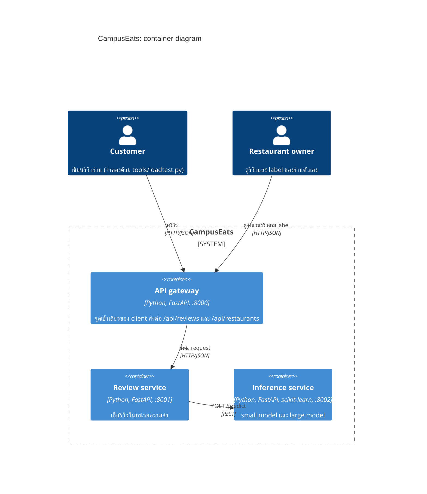
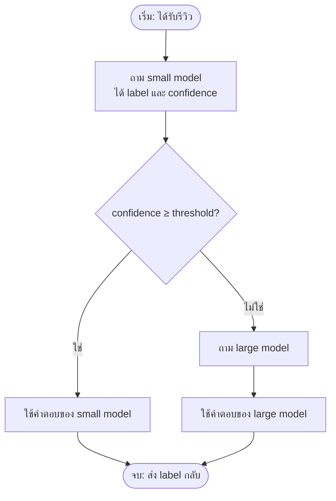

# Tutorial 6: Design patterns สำหรับระบบที่มี AI

**2110521 Software Architecture · สัปดาห์ที่ 13** · [English](README.en.md)

*งานนี้เป็น**งานเดี่ยว** นิสิตแต่ละคนทำและส่งงานของตัวเอง โดยใช้ forked repository ของตัวเอง*
## ไฟล์ที่ใช้เป็นคำตอบ
* `worksheet/task1-3.md`
* `worksheet/task4.md`

## ข้อมูลเบื้องต้นของระบบ CampusEats

CampusEats คือแอปสั่งอาหารในมหาวิทยาลัยซึ่งอนุญาตให้ลูกค้าเขียนรีวิวร้าน ทุกรีวิวจะถูกประมวลผลด้วยโมเดล Machine learning และสร้าง sentiment label (positive / negative) ให้กับรีวิวนั้นๆ เพื่อให้เจ้าของร้านเห็นลูกค้าที่ไม่พอใจได้เร็วและปรับปรุงการให้บริการได้ทันท่วงที

ใน repository นี้ นิสิตจะได้ระบบที่ทำงานได้อยู่แล้ว ซึ่งประกอบด้วย 3 services งานของนิสิตคือเพิ่ม design pattern 3 แบบ รอบตัวโมเดล ได้แก่
* (1) fallback prediction
* (2) cascade (two-phase prediction)
* (3) cached predictions 

จากนั้นวัดผลว่าแต่ละ pattern ส่งผลต่อ latency, cost และ accuracy ของระบบอย่างไร แล้วใช้ตัวเลขเหล่านั้นเลือก deployment topology

C4 container diagram ของระบบ CampusEats เป็นดังด้านล่าง



| Service | Folder | งานของนิสิต |
|---|---|---|
| API gateway | `gateway/` | ไม่มี |
| Review service: business service | `review_service/` | **Task 1** ใน `fallback.py` |
| Inference service: model as a service | `inference_service/` | **Task 2 และ 3** ใน `patterns.py` |

## Requirements ของ CampusEats

Requirements ด้านล่างนี้เป็นของระบบปัจจุบัน ระหว่างการทำแบบฝึกหัดนี้ นิสิตจะเปลี่ยนหรือเพิ่ม requirements เหล่านี้บางส่วน

**Functional requirements**

| # | Requirement |
|---|---|
| FR1 | ลูกค้าโพสต์รีวิวร้านได้ (ชื่อร้าน และข้อความรีวิว) |
| FR2 | ทุกรีวิวได้ sentiment label (`positive` หรือ `negative`) |
| FR3 | เจ้าของร้านดูจำนวนรีวิวแยกตาม label ของร้านตัวเองได้ |
| FR4 | ถ้าติด label ไม่ได้ ให้บันทึกรีวิวไว้เป็น `pending` เพื่อติด label ทีหลัง (รีวิวต้องไม่หาย) |

**Non-functional (Quality) requirements**

| # | Quality | Requirement |
|---|---|---|
| QR1 | Performance | 95% ของรีวิวได้คำตอบภายใน 1 วินาที เมื่อมี requests พร้อมกัน 10 รายการ |
| QR2 | Availability | ถ้า inference service ช้าหรือค้าง การโพสต์รีวิวต้องไม่ล้มเหลว review service รอได้ไม่เกิน 1 วินาที |
| QR3 | Accuracy | label ถูกต้องอย่างน้อย 90% ของรีวิวที่ได้ label |
| QR4 | Cost | ส่งรีวิวไปที่ large model ให้น้อยที่สุด โดยไม่ทำให้ผิด QR3 |
| QR5 | Capacity | ระบบต้องทำงานได้ภายในข้อจำกัดของ large model: สูงสุด 20 calls ต่อวินาที (พร้อมกัน 4 calls × ประมาณ 200 ms) |

## โมเดล 2 ตัว และ strategy 3 แบบ

ใน Inference service ของระบบนี้มีโมเดลจำแนก sentiment ให้ **2 ตัว** (ดูโค้ดได้ใน `inference_service/models.py`) ทั้งสองตัวถูก train จาก `data/train.csv` 

| | Small model | Large model |
|---|---|---|
| สิ่งที่โมเดลดู | คำเดี่ยวๆ ที่พบบ่อยที่สุด 100 คำ (bag of words) | คำเดี่ยว คู่คำ และกลุ่ม 3 คำ (TF-IDF, 1–3-grams) จึงเข้าใจวลีอย่าง "not bad" ได้ |
| ความเร็ว | ไม่ถึง 1 ms ต่อ call | ประมาณ 200 ms ต่อ call และรันพร้อมกันได้แค่ 4 calls |
| ความแม่นยำ | ต่ำกว่า: มักอ่านประโยคปฏิเสธ ("not cold") และประโยคที่มี "but" ผิด | สูงกว่า |
| Cost | แทบเป็นศูนย์ | ทุก call มีค่าใช้จ่าย |

Large model ในแบบฝึกหัดนี้แทน ML model ราคาแพง เช่น โมเดลขนาดใหญ่ที่ต้องรันบน GPU หรือ LLM API แบบเสียเงิน ผลการทำนายเป็นของจริง แต่ความช้าเป็นการจำลอง

ทั้งสองโมเดลตอบเหมือนกัน คือ **label** และ **confidence** ซึ่งเป็นความน่าจะเป็นที่โมเดลให้กับ label ที่เลือก มีค่าตั้งแต่ 0.5 (เดาสุ่ม) ถึง 1.0 (มั่นใจมาก) ตัวอย่างคำตอบของ `POST /predict`:

```json
{"label": "negative", "confidence": 0.93, "model": "large", "latency_ms": 212.4}
```

**Strategy** คือวิธีที่ inference service ใช้โมเดลทั้งสองในการตอบแต่ละ request เลือกได้ด้วย `--strategy` ของ load test:

- **`large`** (ค่าเริ่มต้น): ทุกรีวิวไปที่ large model แม่นที่สุด แต่ช้าและแพงที่สุด
- **`small`**: ทุกรีวิวไปที่ small model เร็วและถูกที่สุด แต่แม่นน้อยกว่า
- **`cascade`** (นิสิต implement ใน Task 2): ถาม small model ก่อน ถ้า confidence สูงพอ (ไม่ต่ำกว่า `--threshold`) ก็ใช้คำตอบนั้นเลย ถ้าไม่ จึงส่งรีวิวต่อไปที่ large model เป้าหมายคือให้ใกล้เคียงความแม่นของ large model โดยจ่าย cost ของ large model เฉพาะรีวิวที่ยาก



Cascade ไม่ใช่โมเดลตัวที่ 3 แต่เป็นการใช้โมเดล 2 ตัวที่มีอยู่ร่วมกัน ใน Task 0 นิสิตจะวัดว่า `large` และ `small` ต่างกันเท่าไร และใน Task 2 จะวัดว่า cascade อยู่ตรงไหนระหว่างสองแบบนั้น

## การเตรียม Environment

ต้องมี **Python 3.10 ขึ้นไป** และ **git**

1. **Fork** repository นี้บน GitHub แล้ว clone **fork ของตัวเอง**
2. สร้าง virtual environment และติดตั้ง packages:

   ```bash
   cd swarch-arch4AI
   python3 -m venv .venv                # Windows: py -m venv .venv
   source .venv/bin/activate            # Windows: .venv\Scripts\activate
   pip install -r requirements.txt
   ```

3. ทดสอบว่ารันได้:

   ```bash
   python run_all.py
   ```

   ต้องเห็น URL 3 บรรทัดและข้อความ "All services are up" จากนั้นกด **Ctrl+C** เพื่อหยุด

## วิธีทำงาน

เปิด **terminal 2 หน้าต่าง** และ activate virtual environment ทั้งสองหน้าต่าง:

- **Terminal 1:** `python run_all.py` ต้อง restart (Ctrl+C แล้วรันใหม่) **ทุกครั้งที่แก้โค้ด**
- **Terminal 2:** รัน tests และ load tests

ในกล่องคำสั่ง บรรทัดที่ขึ้นต้นด้วย `#` เป็น comment ไม่ต้องพิมพ์ (Windows cmd ไม่รู้จัก comment แบบ `#`)

Load test จะส่งรีวิว 200 รายการผ่าน gateway แล้วพิมพ์ผลออกมา 1 แถว ทุกแถวจะถูกต่อท้ายใน `results/runs.csv` ด้วย (ไฟล์นี้ต้องส่ง)

```bash
python tools/loadtest.py --name baseline
```

ตัวอย่างผลลัพธ์:

```text
  200/200 requests
  finished in 10.0 s

  name      hang_rate  strategy  threshold  cache  n    p50_ms  p95_ms  errors  pending  accuracy  large_calls  cache_hits
  baseline  0.0        large                off    200  497     581     0       0        93.5%     100%         0%
```

| Column | ความหมาย |
|---|---|
| `name` | ชื่อของ run ที่ตั้งด้วย `--name` |
| `hang_rate` | สัดส่วนของ calls ไปยัง large model ที่ถูกทำให้ค้าง 20 วินาที (`--hang-rate`, ใช้ใน Task 1) |
| `strategy` | โมเดลที่ใช้ตอบ (`--strategy`): `large` (ค่าเริ่มต้น), `small` หรือ `cascade` (ที่นิสิตต้องทำใน Task 2) |
| `threshold` | confidence threshold ของ cascade (`--threshold`) แสดงค่าว่างถ้า strategy ไม่ใช่ `cascade` |
| `cache` | เปิดหรือปิด prediction cache (`--cache on`, ที่นิสิตต้องทำใน Task 3) |
| `n` | จำนวนรีวิวที่ส่งใน run นี้ |
| `p50_ms`, `p95_ms` | latency ที่ client เห็น: p50_ms = ครึ่งหนึ่ง / p95_ms = 95% ของ requests เร็วกว่าค่านี้ |
| `errors` | requests ที่ล้มเหลว หรือไม่ได้คำตอบภายใน 10 วินาที |
| `pending` | รีวิวที่ถูกบันทึกโดยยังไม่มี label (fallback ใน Task 1) |
| `accuracy` | สัดส่วน label ที่ถูก ในรีวิวที่ได้ label |
| `large_calls` | สัดส่วน requests ที่ไปถึง large model: นี่คือ **cost** |
| `cache_hits` | สัดส่วน requests ที่ตอบจาก cache |

#### Note 1: อ่าน `p50_ms` และ `p95_ms` อย่างไร 
Load test จับเวลาแต่ละ request ตั้งแต่ client ส่งรีวิวจนได้คำตอบกลับ (หน่วยเป็น millisecond) แล้วเรียงเวลาทั้งหมดจากเร็วไปช้า:

- **`p50_ms` (median, percentile ที่ 50):** เวลาของ request ที่อยู่ตรงกลาง ครึ่งหนึ่งของ requests เร็วกว่าค่านี้ และอีกครึ่งช้ากว่า นี่คือประสบการณ์ของผู้ใช้ "ทั่วไป"
- **`p95_ms` (percentile ที่ 95):** 95% ของ requests เร็วกว่าค่านี้ ใน 200 requests คือ request ที่ช้าเป็นอันดับประมาณที่ 10 นี่คือ **tail latency**: ประสบการณ์ของผู้ใช้ที่โชคไม่ดี

ตัวอย่าง: ในผลด้านบน `p50_ms` = 497 และ `p95_ms` = 581 แปลว่าครึ่งหนึ่งของรีวิวได้คำตอบภายในประมาณครึ่งวินาที และ 19 ใน 20 รีวิวได้คำตอบภายใน 0.58 วินาที ส่วนอีก 1 ใน 20 ช้ากว่านั้น

#### Note 2: นิสิตจะเขียนโค้ดเองหรือใช้ AI agent ก็ได้
แต่ละ task จะใส่ไว้เป็น TODO สั้นๆ (4–25 บรรทัด) นิสิตจะเขียนเอง หรือสั่ง coding agent ตัวใดก็ได้ (Copilot, Claude Code, Codex, Cursor, …) กฎของ agent อยู่ใน [`AGENTS.md`](AGENTS.md) **อย่างไรก็ดี คำตอบของคำถามและ ADR ต้องเป็นเหตุผลของนิสิตเอง**

## Tasks

ให้นิสิตเขียนผลและคำตอบลงใน [`worksheet/task1-3.md`](worksheet/task1-3.md)

| เวลา | ขั้นตอน |
|---|---|
| 0:00 | **Task 0** Baseline (10 นาที) |
| 0:10 | **Task 1** Fallback prediction (15 นาที) |
| 0:25 | **Task 2** Cascade (20 นาที) |
| 0:45 | **Task 3** Cached predictions (10 นาที) |
| 0:55 | **Task 4** Deployment decision (15 นาที) |
| 1:10 | Debrief แล้ว commit, push และส่งงาน (5 นาที) |

# Task 0: Baseline

```bash
# ทุกรีวิวไปที่ large model
python tools/loadtest.py --name t0-large
# ทุกรีวิวไปที่ small model
python tools/loadtest.py --name t0-small --strategy small
```
ให้นิสิตสังเกตผลของการรันทั้งสองครั้ง ว่าแตกต่างกันอย่างไร ระหว่าง large และ small models

# Task 1: Fallback prediction (`review_service/fallback.py`)

ใน Task นี้เราจะจำลองความล้มเหลวของระบบโดยตั้งใจ (เรียกว่า **chaos testing** หรือ chaos engineering) เพื่อดูว่าระบบรับมือได้หรือไม่ ก่อนที่จะเจอปัญหาจริงใน production

Option `--hang-rate 0.1` สั่งให้ large model **ค้าง** ใน 10% ของ calls (สุ่ม 1 ใน 10 calls): call นั้นจะรอ 20 วินาทีก่อนตอบ โดยไม่ crash ไม่คืน error และไม่มีอะไรขึ้นใน log เลย อีก 90% ทำงานตามปกติ อาการนี้เกิดได้จริง เช่น GPU server ที่ทำงานหนักเกินไป หรือ LLM API ที่ค้างไปเฉยๆ และอันตรายกว่า crash เพราะไม่มีใครรู้ว่ามีปัญหา ส่วน client ใน load test จะรอได้แค่ 10 วินาที จากนั้นจะนับ request นั้นเป็น `errors`

```bash
python tools/loadtest.py --name t1-before --hang-rate 0.1
```
### งานที่ต้องทำใน Task 1
ดู `errors` และเวลาที่ run ใช้ จากนั้นเขียนโค้ดใน `classify()` โดยใส่ timeout ให้ call (`settings.INFERENCE_TIMEOUT_S` = 1 วินาที) และเมื่อ timeout หรือ error ให้คืนรีวิวสถานะ **pending** แทนการล้มเหลว โดยที่รีวิวยังถูกบันทึก และ batch job สามารถมาติด label ให้รีวิวทีหลังได้

```bash
# 1) run unit test
python -m pytest tests/test_task1_fallback.py
# 2) กลับไป restart run_all.py ใน terminal 1 (กด Ctrl+C แล้วรันอีกครั้ง)
# 3) รัน load test อีกครั้ง
python tools/loadtest.py --name t1-after --hang-rate 0.1
```

คำอธิบาย 3 ขั้นตอนนี้ตามลำดับ:

1. **รัน unit tests (ผ่าน `pytest`):** เพื่อตรวจว่า `classify()` ทำงานถูกต้อง Tests จะสร้าง inference service ปลอมขึ้นมา 3 แบบ: แบบที่ตอบปกติ แบบที่ค้าง และแบบที่ตอบ HTTP 500 แล้วเช็กว่า `classify()` คืน `scored` หรือ `pending` ถูกต้องและเร็วพอ ขั้นตอนนี้ไม่ต้องรัน services จริง ใช้เวลาไม่กี่วินาที และถ้าผิด ข้อความจะบอกว่าผิดตรงไหน จึงควรทำให้ผ่านก่อน
2. **Restart `run_all.py`:** services ที่รันอยู่ใน terminal 1 โหลดโค้ด *ตอนเริ่มทำงาน* และจะไม่เห็นโค้ดที่นิสิตแก้จนกว่าจะ restart (Ctrl+C แล้วรัน `python run_all.py` ใหม่) ถ้าลืมขั้นตอนนี้ load test จะยังวัดโค้ดเดิม และผลจะเหมือน `t1-before` ทุกอย่าง
3. **รัน load test (`t1-after`):** unit tests บอกว่าโค้ด *ถูก* แต่ไม่ได้บอกว่าระบบทั้งระบบ *ดีขึ้นแค่ไหน* Load test วัดผลของ fallback ต่อทั้งระบบภายใต้ chaos แบบเดียวกับ `t1-before` (`--hang-rate 0.1` และรีวิว 200 รายการชุดเดิม) จึงเปรียบเทียบสองแถวนี้ได้: ดูว่า `errors`, `pending`, `p95_ms` และเวลาที่ run ใช้เปลี่ยนไปอย่างไร ผลจะถูกบันทึกใน `results/runs.csv` เพื่อใช้ตอบ worksheet

# Task 2: Cascade (`inference_service/patterns.py`)

ให้นิสิตแก้ไขโค้ดใน `cascade()` ให้ถาม small model ก่อน และจะถาม large model เฉพาะเมื่อ confidence ของ small model ต่ำกว่า threshold เท่านั้น

เมื่อแก้ไขโค้ดเสร็จแล้ว ให้ทดลองรันการทดสอบ load test อีกครั้ง

```bash
python -m pytest tests/test_task2_cascade.py
# restart run_all.py แล้วลองหลายๆ threshold:
python tools/loadtest.py --name t2-0.6 --strategy cascade --threshold 0.6
python tools/loadtest.py --name t2-0.7 --strategy cascade --threshold 0.7
python tools/loadtest.py --name t2-0.8 --strategy cascade --threshold 0.8
python tools/loadtest.py --name t2-0.9 --strategy cascade --threshold 0.9
```
ให้นิสิตสังเกตว่าผลลัพธ์ที่ได้ แตกต่างไปอย่างไร?

# Task 3: Cached predictions (`inference_service/patterns.py`)

ใน Task3 นี้ นิสิตจะต้องแก้ไข `PredictionCache` ให้ข้อความรีวิวเดียวกัน (ไม่สนตัวพิมพ์เล็ก/ใหญ่และช่องว่างที่เกินมา) จะได้คำตอบเดิมที่เก็บไว้ (cached) ซึ่งจะเก็บได้ไม่เกิน `max_size` รายการ และเมื่อเต็มให้ลบรายการที่ไม่ได้ใช้นานที่สุด (least recently used)

```bash
python -m pytest tests/test_task3_cache.py
# restart run_all.py แล้วใช้ threshold ที่เลือกจาก Task 2:
python tools/loadtest.py --name t3-cache --strategy cascade --threshold 0.7 --cache on
```
เปรียบเทียบผลกับตอนก่อนใช้ Cached predictions ว่าแตกต่างกันอย่างไร

# Task 4: Deployment topologies and trade-offs

ใน Task 4 นี้ ให้นิสิตทำตาม [`worksheet/task4.md`](worksheet/task4.md): โดยเลือก deployment topology ที่เหมาะสมสำหรับ scenario ของ CampusEats ให้นิสิตสนับสนุนการตัดสินใจด้วยตัวเลขที่วัดได้ และบันทึกเป็น ADR

## การส่งงาน 

```bash
git add worksheet/ results/ review_service/ inference_service/
git commit -m "Tutorial 6"
git push
```

ส่ง **URL ของ fork** ใน MyCourseVille

## แก้ปัญหา

| ปัญหา | วิธีแก้ |
|---|---|
| `Cannot reach the services` | `python run_all.py` รันอยู่ใน terminal อีกหน้าต่างหรือไม่ |
| `address already in use` | `run_all.py` รอบก่อนยังรันอยู่ หยุดด้วย Ctrl+C หรือปิด terminal นั้น |
| ทุก request ล้มเหลว และมี `NotImplementedError` ใน terminal 1 | strategy ที่รันอยู่ยังไม่ได้ทำ TODO |
| แก้โค้ดแล้วไม่มีผล | restart `run_all.py` ทุกครั้งที่แก้โค้ด |
| `ModuleNotFoundError` | activate virtual environment และรันคำสั่งจาก root folder ของ repository |
| port 8000–8002 ถูกโปรแกรมอื่นใช้อยู่ | ตั้ง port อื่นใน **ทั้งสอง** terminal ก่อนรันคำสั่งใดๆ:<br>macOS/Linux: `export GATEWAY_PORT=9000 REVIEW_PORT=9001 INFERENCE_PORT=9002`<br>Windows PowerShell: `$env:GATEWAY_PORT=9000; $env:REVIEW_PORT=9001; $env:INFERENCE_PORT=9002`<br>Windows cmd: `set GATEWAY_PORT=9000`, `set REVIEW_PORT=9001` และ `set INFERENCE_PORT=9002` |
| Windows PowerShell: `running scripts is disabled on this system` ตอน activate | รัน `Set-ExecutionPolicy -Scope CurrentUser RemoteSigned` ครั้งเดียว แล้ว activate ใหม่ หรือใช้ cmd แทน PowerShell |
| Windows: พิมพ์ `python3` แล้วเปิด Microsoft Store | ใช้ `py` แทน `python3` ตอนสร้าง virtual environment: `py -m venv .venv` |
| Ubuntu/Debian: `ensurepip is not available` ตอนสร้าง venv | ติดตั้ง venv package (`sudo apt install python3-venv`) แล้วสร้าง venv ใหม่ และเช็กว่า `python3 --version` เป็น 3.10 ขึ้นไป |
