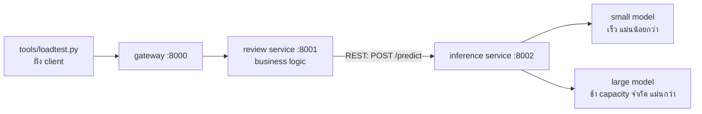

# Tutorial 6: Serving patterns สำหรับระบบที่มี AI

**2110521 Software Architecture · สัปดาห์ที่ 13** · [English](README.en.md)

CampusEats คือแอปสั่งอาหารในมหาวิทยาลัย ลูกค้าเขียนรีวิวร้านอาหาร และทุกรีวิวจะถูกติด sentiment label (positive / negative) ด้วยโมเดล ML เพื่อให้เจ้าของร้านเห็นลูกค้าที่ไม่พอใจได้เร็ว

นิสิตจะได้ระบบที่ทำงานได้แล้ว 3 services หน้าที่ของนิสิตคือเพิ่ม pattern 3 ตัวจาก lecture รอบตัวโมเดล ได้แก่ **fallback prediction**, **cascade (two-phase prediction)** และ **cached predictions** จากนั้นวัดผลว่าแต่ละ pattern ส่งผลต่อ latency, cost และ accuracy อย่างไร แล้วใช้ตัวเลขเหล่านั้นเลือก deployment topology ใน **Assignment 6**



| Service | Folder | งานของนิสิต |
|---|---|---|
| API gateway (แบบเดียวกับ W11) | `gateway/` | ไม่มี |
| Review service: business service | `review_service/` | **Task 1** ใน `fallback.py` |
| Inference service: model as a service | `inference_service/` | **Task 2 และ 3** ใน `patterns.py` |

Large model ในแลบนี้แทนโมเดลราคาแพง เช่น โมเดลที่รันบน GPU หรือ LLM API แบบเสียเงิน ผลทำนายเป็นของจริง แต่ความช้าเป็นการจำลอง: แต่ละ call ใช้เวลาประมาณ 200 ms และรันพร้อมกันได้แค่ 4 calls

## ก่อนเข้าเรียน (ทำที่บ้าน ประมาณ 10 นาที)

ต้องมี **Python 3.10 ขึ้นไป** และ **git** ไม่ต้องใช้ Docker และไม่ต้องมี API key

1. **Fork** repository นี้บน GitHub แล้ว clone **fork ของตัวเอง**
2. สร้าง virtual environment และติดตั้ง packages:

   ```bash
   cd swarch-arch4AI
   python3 -m venv .venv                # Windows: py -m venv .venv
   source .venv/bin/activate            # Windows: .venv\Scripts\activate
   pip install -r requirements.txt
   ```

3. ทดสอบว่ารันได้:

   ```bash
   python run_all.py
   ```

   ต้องเห็น URL 3 บรรทัดและข้อความ "All services are up" จากนั้นกด **Ctrl+C** เพื่อหยุด

## วิธีทำงาน

เปิด **terminal 2 หน้าต่าง** และ activate virtual environment ทั้งสองหน้าต่าง:

- **Terminal 1:** `python run_all.py` ต้อง restart (Ctrl+C แล้วรันใหม่) **ทุกครั้งที่แก้โค้ด**
- **Terminal 2:** รัน tests และ load tests

Load test จะส่งรีวิว 200 รายการผ่าน gateway แล้วพิมพ์ผลออกมา 1 แถว ทุกแถวจะถูกต่อท้ายใน `results/runs.csv` ด้วย (ไฟล์นี้ต้องส่ง)

```bash
python tools/loadtest.py --name baseline
```

| Column | ความหมาย |
|---|---|
| `p50_ms`, `p95_ms` | latency ที่ client เห็น: ครึ่งหนึ่ง / 95% ของ requests เร็วกว่าค่านี้ |
| `errors` | requests ที่ล้มเหลว หรือไม่ได้คำตอบภายใน 10 วินาที |
| `pending` | รีวิวที่ถูกบันทึกโดยยังไม่มี label (fallback ใน Task 1) |
| `accuracy` | สัดส่วน label ที่ถูก ในรีวิวที่ได้ label |
| `large_calls` | สัดส่วน requests ที่ไปถึง large model: นี่คือ **cost** |
| `cache_hits` | สัดส่วน requests ที่ตอบจาก cache |

**จะเขียนโค้ดเองหรือใช้ AI agent ก็ได้** แต่ละ task เป็น TODO สั้นๆ (4–25 บรรทัด) จะเขียนเอง หรือสั่ง coding agent ตัวใดก็ได้ (Copilot, Gemini Code Assist, Claude Code, Codex, Cursor, …) กฎของ agent อยู่ใน [`AGENTS.md`](AGENTS.md) ไม่ว่าแบบไหน ให้บันทึกใน worksheet ว่าแต่ละ task ทำอย่างไร และต้องแก้อะไรบ้าง **คำตอบของคำถามและ ADR ต้องเป็นเหตุผลของนิสิตเอง**

## Tasks (ประมาณ 75 นาที)

เขียนผลและคำตอบลงใน [`worksheet/tutorial6.md`](worksheet/tutorial6.md)

| เวลา | ขั้นตอน |
|---|---|
| 0:00 | **Task 0** Baseline (10 นาที) |
| 0:10 | **Task 1** Fallback prediction (15 นาที) |
| 0:25 | **Task 2** Cascade (20 นาที) |
| 0:45 | **Task 3** Cached predictions (10 นาที) |
| 0:55 | **Assignment 6** Deployment decision (15 นาที) |
| 1:10 | Debrief แล้ว commit, push และส่งงาน (5 นาที) |

### Task 0: Baseline

```bash
python tools/loadtest.py --name t0-large                    # ทุกรีวิวไปที่ large model
python tools/loadtest.py --name t0-small --strategy small   # ทุกรีวิวไปที่ small model
```

### Task 1: Fallback prediction (`review_service/fallback.py`)

เปิด chaos: 10% ของ calls ไปยัง large model จะ **ค้าง** 20 วินาที โดยไม่มี error และไม่มี log ใดๆ

```bash
python tools/loadtest.py --name t1-before --hang-rate 0.1
```

ดู `errors` และเวลาที่ run ใช้ จากนั้น implement `classify()`: ใส่ timeout ให้ call (`settings.INFERENCE_TIMEOUT_S` = 1 วินาที) และเมื่อ timeout หรือ error ให้คืนรีวิวสถานะ **pending** แทนการล้มเหลว รีวิวยังถูกบันทึก และ batch job สามารถติด label ทีหลังได้

```bash
python -m pytest tests/test_task1_fallback.py
# restart run_all.py แล้ว:
python tools/loadtest.py --name t1-after --hang-rate 0.1
```

### Task 2: Cascade (`inference_service/patterns.py`)

Implement `cascade()`: ถาม small model ก่อน และถาม large model เฉพาะเมื่อ confidence ของ small model ต่ำกว่า threshold

```bash
python -m pytest tests/test_task2_cascade.py
# restart run_all.py แล้วลองหลายๆ threshold:
python tools/loadtest.py --name t2-0.6 --strategy cascade --threshold 0.6
python tools/loadtest.py --name t2-0.7 --strategy cascade --threshold 0.7
python tools/loadtest.py --name t2-0.8 --strategy cascade --threshold 0.8
python tools/loadtest.py --name t2-0.9 --strategy cascade --threshold 0.9
```

### Task 3: Cached predictions (`inference_service/patterns.py`)

Implement `PredictionCache`: ข้อความรีวิวเดียวกัน (ไม่สนตัวพิมพ์เล็ก/ใหญ่และช่องว่างที่เกินมา) จะได้คำตอบที่เก็บไว้ เก็บได้ไม่เกิน `max_size` รายการ และเมื่อเต็มให้ลบรายการที่ไม่ได้ใช้นานที่สุด (least recently used)

```bash
python -m pytest tests/test_task3_cache.py
# restart run_all.py แล้วใช้ threshold ที่เลือกจาก Task 2:
python tools/loadtest.py --name t3-cache --strategy cascade --threshold 0.7 --cache on
```

### Assignment 6: Deployment topologies and trade-offs

ทำตาม [`worksheet/assignment6.md`](worksheet/assignment6.md): เลือก deployment topology สำหรับ scenario หนึ่งของ CampusEats สนับสนุนด้วยตัวเลขที่วัดได้ และบันทึกเป็น ADR

### Stretch (ไม่บังคับ)

- **Fallback ไปที่โมเดลในเครื่อง** แทนที่จะคืน `pending` ให้ fallback ไปที่ small model ที่รัน *ภายใน* review service (model as a library) แล้ว accuracy, latency และ coupling เปลี่ยนไปอย่างไร
- **ติด label ให้รีวิวที่ pending ภายหลัง** เขียน batch job เล็กๆ ที่อ่าน `GET /reviews/pending` แล้วติด label: นี่คือ batch processing topology จาก lecture

## การส่งงาน (ภายในคาบ)

```bash
git add worksheet/ results/ review_service/ inference_service/
git commit -m "Tutorial 6 and Assignment 6"
git push
```

ส่ง **URL ของ fork** ใน MyCourseVille

## แก้ปัญหา

| ปัญหา | วิธีแก้ |
|---|---|
| `Cannot reach the services` | `python run_all.py` รันอยู่ใน terminal อีกหน้าต่างหรือไม่ |
| `address already in use` | `run_all.py` รอบก่อนยังรันอยู่ หยุดด้วย Ctrl+C หรือปิด terminal นั้น |
| ทุก request ล้มเหลว และมี `NotImplementedError` ใน terminal 1 | strategy ที่รันอยู่ยังไม่ได้ทำ TODO |
| แก้โค้ดแล้วไม่มีผล | restart `run_all.py` ทุกครั้งที่แก้โค้ด |
| `ModuleNotFoundError` | activate virtual environment และรันคำสั่งจาก root folder ของ repository |
| port 8000–8002 ถูกโปรแกรมอื่นใช้อยู่ | ตั้ง port อื่น เช่น `GATEWAY_PORT=9000 REVIEW_PORT=9001 INFERENCE_PORT=9002` ใน **ทั้งสอง** terminal |
