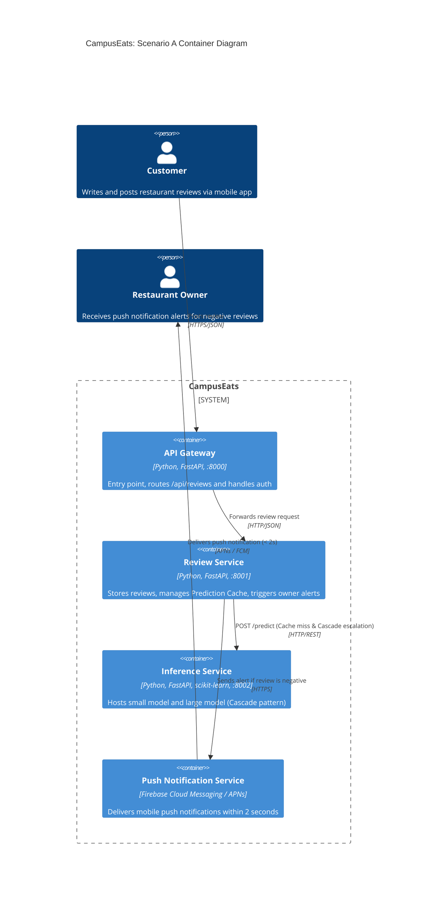

# Task 4: Deployment topologies and trade-offs

**Name / ชื่อ:** Chanatda Konchom

**Student ID / รหัสนิสิต:** 6631305321

This is **individual work**: each student completes and submits their own copy, in their own fork.

*งานนี้เป็น**งานเดี่ยว** นิสิตแต่ละคนทำและส่งงานของตัวเอง ใน fork ของตัวเอง*

**Scenario (A, B or C) / Scenario ที่เลือก:** A

Choose **one** scenario below. If the last digit of your student ID is odd, take A or B; if it is even, take B or C. Use your measurements from Tutorial 6 as evidence: cite run names from `results/runs.csv`. Answer in Thai or English.

เลือก scenario **หนึ่ง** ข้อด้านล่าง ถ้าเลขตัวสุดท้ายของรหัสนิสิตเป็นเลขคี่ ให้เลือก A หรือ B ถ้าเป็นเลขคู่ ให้เลือก B หรือ C ใช้ผลการวัดจาก tutorial ที่ทำไปเป็นข้อมูลอ้างอิง โดยอ้างชื่อ run จาก `results/runs.csv` จะตอบเป็นภาษาไทยหรือภาษาอังกฤษก็ได้

Facts that hold in every scenario / ข้อเท็จจริงที่ใช้กับทุก scenario:

- The large model serves at most **20 calls per second** (4 calls at once × about 200 ms each), and every call costs money.

  *large model รับได้สูงสุด **20 calls ต่อวินาที** (พร้อมกัน 4 calls × ประมาณ 200 ms ต่อ call) และทุก call มีค่าใช้จ่าย*
- The small model is fast and cheap enough to run anywhere, including inside the review service or on a kiosk, but it is much less accurate on its own.

  *small model เร็วและถูกพอที่จะรันที่ไหนก็ได้ รวมถึงภายใน review service หรือบน kiosk แต่ถ้าใช้ตัวเดียวจะแม่นน้อยกว่ามาก*

## Scenarios

**A. Owner alerts.** When a customer posts a negative review, the restaurant owner gets a push notification within **2 seconds**. At the lunch peak, CampusEats receives **40 reviews per second**. A missed alert is acceptable, but a wrong alert (for example, "your customer is unhappy" when they are happy) makes owners stop trusting alerts and, in the end, ignore them.

*เมื่อลูกค้าโพสต์รีวิวเชิงลบ เจ้าของร้านจะต้องได้รับ push notification ภายใน **2 วินาที** เวลาช่วงพีคตอนเที่ยง CampusEats ได้รับรีวิวจำนวน **40 รายการต่อวินาที** การพลาด alert ไปบ้างนั้นยอมรับได้ แต่ alert ที่ผิด (เช่น "ลูกค้าไม่พอใจ" ทั้งที่จริงๆ แล้วพอใจ) จะทำให้เจ้าของร้านไม่เชื่อถือและเลิกสนใจ alert ในที่สุด*

**B. Canteen kiosk.** A tablet in each canteen lets students leave a review on the spot. However, the canteen Wi-Fi is poor: the tablets lose their connection several times a day, for minutes at a time. The system must accept every review, even while a tablet is offline. Restaurant owners need the labels **by the end of the day**.

*มี tablet ในแต่ละโรงอาหารให้นิสิตรีวิวได้ทันที อย่างไรก็ดี การเชื่อมต่อ Wi-Fi ในโรงอาหารไม่ดี ทำให้ tablet หลุดการเชื่อมต่อวันละหลายครั้ง ครั้งละหลายนาที ระบบจะต้องรับรีวิวได้ทุกรายการแม้ขณะที่กำลัง offline อยู่ และเจ้าของร้านต้องการ label **ภายในสิ้นวัน***

**C. Weekly report.** Restaurant owners want a weekly sentiment report. Nothing in producing this report has to be real-time. **Accuracy matters most** and **cost must be minimal**.

*เจ้าของร้านต้องการรายงาน sentiment รายสัปดาห์ ไม่มีอะไรที่จะต้องทำแบบ real-time ในการออกรายงานนี้ ความแม่นยำ **(accuracy) สำคัญที่สุด** และ **ค่าใช้จ่ายต้องน้อยที่สุด***

## Topologies and patterns to choose from / Topology และ pattern ที่เลือกใช้ได้

| | Topology | Where the model runs / โมเดลรันที่ไหน |
|---|---|---|
| T1 | Model as a service, synchronous | Inference service, called for each review (today's baseline) *inference service ถูกเรียกทุกรีวิว (baseline ของวันนี้)* |
| T2 | Model as a library | Inside the review service, or on the device *ภายใน review service หรือบนอุปกรณ์* |
| T3 | Hybrid | Small model locally, large model as a remote service *small model รันในเครื่อง large model เป็น remote service* |
| T4 | Asynchronous / batch | Reviews are queued (broker, W10) or stored, and scored later in bulk *รีวิวถูกเข้าคิว (broker, W10) หรือเก็บไว้ แล้วติด label ทีหลังเป็นชุด* |

Combine one topology with any of the patterns from Tutorial 6: **fallback**, **cascade** and **cache**.

*เลือก topology หนึ่งแบบ แล้วผสมกับ pattern จาก Tutorial 6 ได้ตามต้องการ: **fallback**, **cascade** และ **cache***

## 1. Quality requirements

The three most important quality requirements for your scenario, each with a number where possible.

*quality requirements ที่สำคัญที่สุด 3 ข้อของ scenario ที่เลือก ระบุตัวเลขเมื่อทำได้*

| # | Quality | Requirement |
|---|---|---|
| 1 | Performance (Latency) | Push notification delivered to the restaurant owner within 2.0 seconds of review submission (p95 <= 2.0 s). |
| 2 | Capacity / Throughput | Must sustain lunch peak of 40 reviews/second while keeping large model calls <= 20 calls/second. |
| 3 | Accuracy | Sentiment accuracy >= 90% (target >= 93%) to prevent false negative alerts from damaging owner trust. |

## 2. Design / การออกแบบ

Your topology, the patterns you add, and a container-level diagram (C4 level 2). The C4 diagram must be written in Mermaid.

*topology ที่เลือก pattern ที่เพิ่ม และ diagram ระดับ container (C4 level 2) เขียนด้วย Mermaid*

**Topology & Patterns:**
- **Topology**: **T3 (Hybrid)** / **T1 (Model as a Service)** with remote Inference Service
- **Patterns**:
  - **Prediction Cache**: Normalized LRU cache in front of models to answer repeated common reviews with zero latency and zero inference cost.
  - **Cascade (confidence threshold = 0.7)**: Queries the fast small model first; only escalates ambiguous reviews (confidence < 0.7) to the expensive large model.
  - **Fallback**: 1.0-second timeout on inference calls that gracefully degrades to `pending` review status rather than violating the 2-second alert deadline or failing requests.

## 3. Evidence / หลักฐาน

Which runs support your choice? Show the numbers and, for scenario A, the capacity arithmetic: how many large-model calls per second does your design need at the peak?

*run ไหนที่สนับสนุนการตัดสินใจของนิสิต ให้นิสิตแสดงตัวเลขประกอบ และสำหรับ scenario A ให้นิสิตแสดงการคำนวณ capacity ด้วย เพื่อแสดงว่าในช่วงพีคนั้น design ของนิสิตต้องใช้ large model กี่ calls ต่อวินาที*

| Run | What it shows / แสดงอะไร |
|---|---|
| t0-large | Baseline: 93.5% accuracy, but requires 100% large calls (exceeds 20 calls/s limit at 40 req/s peak) |
| t2-0.7 | Cascade (0.7): 93.0% accuracy with only 53% large calls (369 ms p50) |
| t3-cache | Cascade + Cache: 93.0% accuracy, 35% cache hits, drops large calls to 38% (15.2 calls/s at peak), p95 is 535 ms (< 2.0 s) |

**Capacity Arithmetic at Lunch Peak (40 reviews/s):**
- **Incoming peak rate**: 40 reviews/second.
- **Large model capacity ceiling**: 20 calls/second (4 concurrent calls x ~200 ms latency).
- **Impact of Cache (35% hit rate from `t3-cache`)**:
  - Reviews resolved by cache: 40 x 0.35 = 14 reviews/second (requiring 0 model calls).
  - Uncached reviews reaching Cascade: 40 - 14 = 26 reviews/second.
- **Impact of Cascade (threshold 0.7)**:
  - From `t3-cache` measurements, total large calls were 38%:
    $$\text{Peak Large Calls} = 40 \times 0.38 = \mathbf{15.2 \text{ calls/second}}$$
- **Capacity verification**:
  $$\mathbf{15.2 \text{ calls/second}} \le \mathbf{20 \text{ calls/second capacity limit}}$$
  The design safely stays under the maximum throughput of the large model during peak lunch rush.
- **Latency verification**:
  - Measured $p95$ latency in `t3-cache` is **535 ms**, well within the 2.0-second alert deadline ($535\text{ ms} \ll 2000\text{ ms}$), leaving ample budget (~1.4s) for the push notification service.

## 4. ADR

Use the ADR format from W5.

*ใช้รูปแบบ ADR จาก W5*

**Title:** ADR: Hybrid Serving Architecture with Cascade, Normalized Cache, and Fallback for Real-Time Sentiment Alerts

**Status:** Proposed

**Context:**
CampusEats requires push notifications delivered to restaurant owners within 2 seconds whenever a customer submits a negative review. During the lunch peak, traffic surges to 40 reviews/second. However, the expensive large sentiment model can serve at most 20 calls/second (4 concurrent slots x ~200 ms). Furthermore, false negative alerts erode owner trust, so high accuracy (>= 90%) must be maintained.

**Decision:**
We adopt a hybrid multi-tier serving architecture combining:
1. **Normalized LRU Prediction Cache**: Preempts model invocation for common phrases (~35% cache hits).
2. **Cascade Pattern (Threshold 0.7)**: Queries the fast small model first, escalating only ambiguous predictions (confidence < 0.7) to the remote large model.
3. **Fallback Prediction (1.0s Timeout)**: Drops timed-out or failed inference requests to `pending` status instead of blocking or dropping reviews, ensuring the 2-second alert deadline is not violated.

**Consequences:**
- **Positive**:
  - **Capacity**: Reduces peak large model calls from 40 calls/s to 15.2 calls/s, operating safely within the 20 calls/s limit.
  - **Latency**: Achieves a p95 latency of 535 ms, comfortably meeting the 2.0-second push notification requirement.
  - **Accuracy**: Delivers 93.0% accuracy (matching QR3 >= 90%), preventing false alerts.
  - **Fault Tolerance**: Fallback ensures 0 client-side errors during latency spikes or transient model hangs.
- **Negative**:
  - **Complexity**: Managing cache invalidation upon model retraining and maintaining dual model versions.
  - **Accuracy Trade-off**: Yields a minor 0.5% accuracy trade-off compared to a 100% large model deployment (93.0% vs 93.5%).

**Alternatives considered:**
- **Rejected Topology T1 (Pure Synchronous Model as a Service without Cascade/Cache)**:
  Routing all 40 reviews/s to the large model exceeds its 20 calls/s ceiling by 100%, causing severe queue buildup, client timeouts, and catastrophic failure during peak hours.
- **Rejected Topology T4 (Asynchronous / Batch Processing)**:
  Batch processing cannot guarantee delivery of notifications within the strict 2-second real-time window required for owner alerts.
